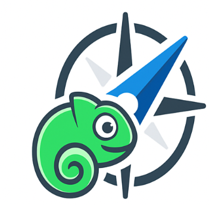

# SUSE Docs Navigator (MCP)

Search SUSE, Rancher, K3s, RKE2, Longhorn, Harvester, NeuVector, and Kubewarden documentation from your browser or from your AI tools, over the Model Context Protocol (MCP).

> **Not an official SUSE product.** This is an independent community project. SUSE, Rancher, and the chameleon are trademarks of SUSE LLC.

- **Live demo:** [mso-docs.github.io/Docs-Navigator-MCP-SUSE-Edition](https://mso-docs.github.io/Docs-Navigator-MCP-SUSE-Edition/). It is a static page that searches a snapshot of the docs in your browser.
- **Directory listing:** [Glama](https://glama.ai/mcp/servers/mso-docs/Docs-Navigator-MCP-SUSE-Edition)
- **Portfolio:** [mso-docs.github.io/mac-portfolio](https://mso-docs.github.io/mac-portfolio/)
- **Hack Week version:** the version submitted for SUSE Hack Week 25 (December 1–5, 2025) is preserved on the [`hackathon-submission`](https://github.com/mso-docs/Docs-Navigator-MCP-SUSE-Edition/tree/hackathon-submission) branch.



## What it does

| MCP tool | Purpose |
| --- | --- |
| `search_docs` | Search one source or all of them |
| `ask_question` | Answer with citations. With no AI model connected, it returns the best passages instead |
| `get_doc_section` | Fetch a documentation page as Markdown |
| `summarize_doc` | Brief, detailed, or bullet-point summary of a page (needs an AI model) |
| `index_documentation` | Crawl and index one source, or all |
| `list_doc_sources` | Show the sources and their index status |

Search needs no model and no key. Keyword search runs on SQLite FTS5 (BM25). If you have Ollama, you can add semantic search with embeddings. AI answers are optional and work with Ollama, Hugging Face Inference Providers (open models), OpenAI, or Anthropic.

## Quickstart

Needs Node.js 22 or newer.

```bash
git clone https://github.com/mso-docs/Docs-Navigator-MCP-SUSE-Edition.git
cd Docs-Navigator-MCP-SUSE-Edition
npm ci
cp .env.example .env          # defaults: keyword search, no AI model

npm run index k3s             # index one source (about 30 pages); try rancher, rke2, longhorn, ...
npm run web                   # web UI at http://localhost:3000
```

Run `npm test` to check the install. The tests run offline and include a real MCP round trip over stdio.

## Connect an MCP client

Replace `/path/to` with the folder you cloned into. These start the server in keyword-search mode; see “AI answers” to turn on a model.

**Claude Desktop** (`claude_desktop_config.json`) and **Cursor** (`~/.cursor/mcp.json`):

```json
{
  "mcpServers": {
    "docs-navigator-suse": {
      "command": "node",
      "args": ["/path/to/Docs-Navigator-MCP-SUSE-Edition/src/index.js"],
      "env": { "SEARCH_MODE": "lexical", "AI_PROVIDER": "none" }
    }
  }
}
```

**Claude Code**:

```bash
claude mcp add docs-navigator-suse -e SEARCH_MODE=lexical -e AI_PROVIDER=none -- node /path/to/Docs-Navigator-MCP-SUSE-Edition/src/index.js
```

**VS Code** (`.vscode/mcp.json`):

```json
{
  "servers": {
    "docs-navigator-suse": {
      "type": "stdio",
      "command": "node",
      "args": ["/path/to/Docs-Navigator-MCP-SUSE-Edition/src/index.js"],
      "env": { "SEARCH_MODE": "lexical", "AI_PROVIDER": "none" }
    }
  }
}
```

Index the sources you care about first (`npm run index k3s`), or call `index_documentation` from your client.

## AI answers

Set `AI_PROVIDER` in `.env`:

| Provider | Settings | Cost |
| --- | --- | --- |
| `none` (default) | nothing | free; `ask_question` returns passages |
| `ollama` | `OLLAMA_MODEL`, `EMBEDDING_MODEL`; run `ollama pull llama3.2 nomic-embed-text` | free, local |
| `huggingface` | `HF_TOKEN` with the “Make calls to Inference Providers” permission, optional `HF_MODEL` | your Hugging Face credits |
| `openai`, `anthropic` | API key and model | paid |

`SEARCH_MODE` is `lexical` (keywords only), `semantic` (embeddings only), or `auto` (embeddings, falling back to keywords). Embeddings need Ollama or OpenAI; the other providers answer questions but cannot embed.

## Docker

```bash
docker build -t docs-navigator-suse .
docker run -i --rm docs-navigator-suse
```

The image runs the stdio MCP server in keyword-search mode. Glama builds from this Dockerfile and `glama.json`.

## Project layout

```
src/index.js          MCP server (stdio)
src/web-server.js     Express server for the web UI
src/services/         documentation, lexical (FTS5), vector, AI, cache, change detection
src/cli/              indexing, analytics, cache tools (npm run ...)
src/tests/            offline tests (npm test) and an Ollama test (npm run test:ollama)
public/               web UI and the static demo data
scripts/              build-demo-index.js, build-sample-answer.js, setup scripts
docs/                 detailed guides
```

More detail: [architecture](docs/ARCHITECTURE.md), [indexing](docs/INDEXING_GUIDE.md), [sources](docs/SOURCES.md), [MCP client setup](docs/MCP_CLIENT_CONFIG.md), [change detection](docs/CHANGE_DETECTION.md), [GitHub Pages demo](docs/GITHUB_PAGES.md).

## License

MIT. See [LICENSE](LICENSE).
